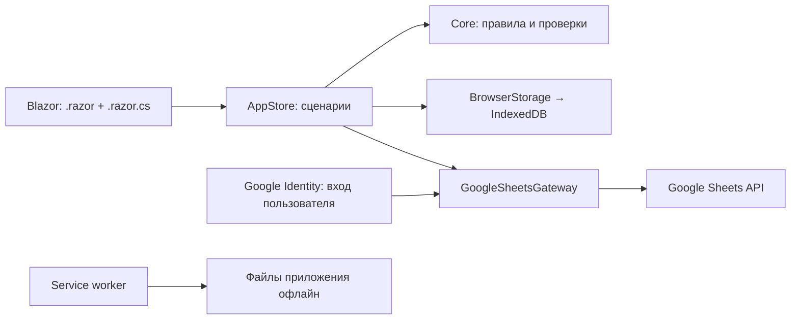

# Устройство приложения

## Почему Blazor WebAssembly

GitHub Pages раздаёт статические файлы. Blazor Server потребовал бы постоянного соединения с сервером и плохо подходил бы для зала с нестабильной сетью. WebAssembly выполняет C# на устройстве; service worker сохраняет файлы приложения, IndexedDB — пользовательские данные.

Схема:

## Данные на устройстве

В хранилище IndexedDB находится одна версионированная запись:

- Настройки: ссылка на лист, публичный Client ID, длительность отдыха.
- Последний успешно загруженный план.
- Выбранная неделя и день.
- Локальные тренировки с результатами по подходам.
- Очередь неизменяемых снимков результатов для отправки.

Одна IndexedDB-транзакция атомарно сохраняет всё состояние. Завершение тренировки и постановка в очередь не могут разойтись из-за закрытия страницы между двумя записями.

Общий ввод веса и повторов проходит через `WorkoutRules.FillRemainingSets` и одну транзакцию `AppStore`. Сначала проверяются оба значения и уже введённый запас; затем оставшиеся подходы заполняются и отмечаются выполненными. Ранее выполненные результаты и очередь не меняются. Сам черновик общего ввода сохраняется при каждом вводе, но не считается выполнением до кнопки «Применить».

`WorkoutSession.IsPaused` отделяет сохранённую тренировку от активной. Выход сохраняет паузу без `FinishedAt` и без очереди. Продолжение использует тот же ID, одновременно активной может быть только одна запись. Старые незавершённые записи мигрируют в паузу; если утром только открыли пустую тренировку, при продолжении время начала обновляется. Настройка `TimerEnabled` хранится вместе с остальными настройками; выход, завершение и выключение таймера останавливают отсчёт.

Необязательный запас проверяется только при непустом вводе. `CellUpdate.WritesReserve` управляет диапазоном Google API, сравнением конфликтов, подтверждением и обновлением локального снимка. При отсутствии запаса его ячейка не входит в запрос и не проверяется на конфликт; существующие значения и формулы остаются нетронутыми. Частичные значения используют прочерки для сохранения номеров подходов.

Перед записью сравнивается `Revision`. Если другая вкладка уже сохранила новую версию, устаревшая вкладка блокирует изменение и сообщает об этом. Внутри вкладки изменения сериализуются через `SemaphoreSlim`.

В интерфейсе состояние заменяется только после подтверждения IndexedDB. При ошибке сохранения показывается сообщение; черновик последней неудачной записи остаётся в памяти для экспорта.

Резервное копирование не содержит OAuth access token. Импорт объединяет тренировки по ID, не заменяя имеющиеся. Подтверждённые Google записи не возвращаются в очередь.

## Отправка результатов

1. Завершённая тренировка превращается в `PendingUpload`.
2. В задании фиксируются ID таблицы, gid, неделя, строка дня, строки упражнений и номера столбцов.
3. В нём также остаются исходные значения «нагрузка / запас» и параметры плана.
4. При синхронизации приложение читает metadata и значения из Google по gid.
5. Проверяет, что строки, упражнения, подходы и плановые повторы всё ещё совпадают.
6. Сравнивает текущие ячейки с исходными и желаемыми.
7. Если везде уже желаемые значения, признаёт предыдущую запись успешной без повторной отправки.
8. Если ячейки не изменились, выполняет `values:batchUpdate` с `RAW`.
9. Читает результат ещё раз и только затем удаляет задание из очереди.

Запись выполняется в конкретные ячейки, поэтому повторный запрос не создаёт дополнительные строки. В формулы приложение не пишет. Имена листов экранируются для A1-диапазонов; название листа определяется по gid, а не предполагается заранее.

## Сбои

| Событие | Поведение |
|---|---|
| Нет сети | План и ввод продолжают работать локально |
| HTTP 429, 5xx, таймаут, сетевой обрыв | Задание остаётся; интервал повторов увеличивается до 5 минут с небольшим случайным сдвигом |
| Сервер записал данные, ответ потерялся | Следующая попытка узнаёт уже записанные ячейки |
| Access token отсутствует или HTTP 401 | Требуется вход; автоматический popup не открывается |
| Нет прав редактора / HTTP 403 | Задание сохраняется; после исправления прав пользователь нажимает «Повторить» |
| Тренер изменил ячейки или перенёс строки | Статус конфликта; тихой перезаписи нет |
| Не хватает места / ошибка IndexedDB | Ввод блокируется с предупреждением; предлагается экспорт черновика |
| Второй экземпляр приложения записал новую версию | Устаревшая вкладка не перезаписывает данные |

Синхронизация запускается при возврате на вкладку, событии `online`, завершении тренировки, входе Google, ручном повторе и проверке раз в 30 секунд. Реальная доступность Google определяется HTTP-ответом: `navigator.onLine` сам по себе не считается подтверждением отправки.

## PWA

- `service-worker.published.js` кэширует весь манифест сборки с проверкой контрольных сумм.
- При незавершённой установке новый неполный кэш удаляется.
- Кэш имеет префикс, зависящий от пути приложения; он не удаляет кэши других сайтов аккаунта.
- Google API и OAuth не кэшируются service worker.
- Навигация внутри приложения получает сохранённый `index.html`.
- После полной загрузки вызывается `skipWaiting`; следующая навигация получает новую сборку даже при открытых старых вкладках.
- `bootstrap.js` сверяет метку сборки страницы и service worker. C# разрешает автоперезагрузку только после завершения записей IndexedDB, без активной тренировки, синхронизации и ошибки хранения. Поле в фокусе и несохранённые настройки также откладывают перезагрузку.
- Прежние файлы с хэшами остаются доступны для старых открытых страниц. Кэши старых сборок удаляются только после подтверждения новой версии всеми открытыми страницами приложения. Неответившие старые вкладки не принуждаются к перезагрузке.
- Список предшествующих кэшей фиксируется при установке и хранится в кэше этой сборки. Очистка никогда не удаляет кэш следующего, параллельно загружаемого обновления.
- IndexedDB не удаляется при смене кэша приложения.

Офлайн-поведение проверяется на **publish**, а не на dev server. Это соответствует модели [Blazor PWA](https://learn.microsoft.com/en-us/aspnet/core/blazor/progressive-web-app/?view=aspnetcore-10.0).

## Границы версии

Решение рассчитано на личное использование. Предварительное сравнение и контрольное чтение защищают от многих конфликтов, но не заменяют серверную транзакцию: другой редактор может изменить ячейку между чтением и записью. Для строгой конкурентной записи потребуется серверный посредник и единый протокол для всех писателей.

Нет background sync с постоянным refresh token: браузерный OAuth token model требует нового действия пользователя при истечении доступа. Для отправки в закрытом приложении понадобится серверный OAuth flow и защищённое хранение refresh tokens.

При расширении рекомендуемый следующий шаг — выделить интерфейсы хранилища и внешнего плана, добавить серверный адаптер без изменения моделей `Core`, затем многопользовательский доступ и миграции состояния.

## Расчёт прогрессии

`PreviousWorkoutFinder` выбирает прошлые результаты, `ProgressionCalculator` отдельно рассчитывает цель. Эти классы находятся в `Core` и не обращаются ни к браузеру, ни к Google. `ProgressionPanel.razor` отвечает за сравнение подходов, а `.razor.cs` — за параметры и их сохранение.

Контекст включает ID таблицы, gid, день, строку, точное название упражнения, неделю и текущую схему. Поиск идёт по более ранним неделям; новая неотправленная локальная запись приоритетнее снимка таблицы. Если отправленные значения позднее изменены в Google, используется содержимое загруженного плана. Неполные данные показываются, но не разрешают автоматическое повышение.

Шаг веса, начальный и конечный запас хранятся по ключу упражнения в `LocalState.ProgressionSettings`. `TechniqueMaintained` имеет три состояния: да, нет, не отмечено. Поля добавлены совместимо со схемой 1: старая история сохраняется, отсутствие оценки не превращается в подтверждение техники. Импорт объединяет настройки без замены существующих.

Алгоритм не заполняет фактические подходы и не меняет очередь отправки. Все цели условны сохранением техники и заданного запаса. Для упражнений с дроп-сетами расчёт относится к основным рабочим подходам; дополнительные сбросы веса остаются указанием тренера в названии.

## Автоматические и браузерные проверки

`node --test tests/WorkoutLog.BrowserTests/pwa.test.mjs` проверяет неполную установку, сохранение старых файлов для открытых страниц, защиту кэша следующей сборки, отсутствие циклов перезагрузки и ожидание окончания тренировки/ввода. В браузере дополнительно проверен переход между опубликованными сборками: обновление ожидает выхода, затем автоматически перезагружает приложение с сохранением результатов и черновиков. После обновления проверены загрузка, общий ввод и завершение при выключенном локальном сервере.

`dotnet test` покрывает:

- CSV с кавычками, запятыми, пустыми строками и переносами;
- выбор листа и перевод номеров столбцов в A1;
- контроль структуры, исходного плана и адресата записи;
- проверку ввода и явное завершение / пропуск;
- неизменность задания после завершения;
- конфликт и уже выполненную запись;
- правильный диапазон и `RAW`-запись API;
- потерю ответа после записи, 401, 403, 429, 503;
- сохранение очереди при перезагрузке;
- ввод десятичного веса посимвольно;
- паузу, продолжение, сохранение черновика общего ввода, настройку таймера и запрет обновления при активной тренировке или ошибке хранения;
- отсутствие записи и конфликта по пустому запасу, сохранение формул Google и повтор после потери ответа;
- общее заполнение подходов одной записью, сохранение выполненных результатов и запаса, отклонение ошибочного ввода без частичных изменений;
- конфликт версий вкладок и ошибку локального сохранения;
- прогрессию повторений, переход к весу, недостаточный запас и нарушение техники;
- неполную историю, изменение плана, разные источники и отсутствие техники в старых данных;
- десятичный шаг веса и перенос параметров/техники через перезагрузку и резервную копию.

Браузерная проверка включает мобильную ширину, заполнение подхода, восстановление после перезагрузки, открытие опубликованной сборки при выключенном сервере и очередь без Google-авторизации. Проверены сравнение прошлых подходов и целей, изменение шага и сохранение отметки техники, включая запуск при выключенном локальном сервере. Общий ввод проверен на ширине 320 и 390 пикселей: изменение только оставшихся подходов, последующая индивидуальная правка, одна раскрытая карточка, сохранение общего ввода при выключенном сервере и перезагрузке. Реальные OAuth и чтение исходной таблицы проверены; тестовые тренировочные значения в неё не записывались.
